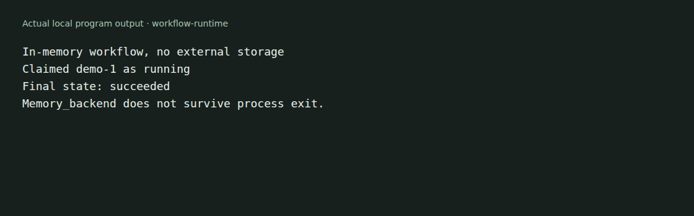

# workflow-runtime

An OCaml library for workflow state, worker claims and execution history. Supply
a storage backend, enqueue work, claim it for a worker and record its outcome.
Optional libraries add an Eio runner and a MongoDB backend.



The example runs in memory. Its state disappears when the process exits. See
[capture details](docs/demo/README.md).

## Try the core example

Use an OCaml 5.2 or later opam switch and Dune 3.22 or later:

```sh
git clone https://github.com/Microapps-Labs/workflow-runtime.git
cd workflow-runtime
opam install dune yojson alcotest
opam exec -- dune exec examples/demo/main.exe
opam exec -- dune exec test/test_workflow_runtime.exe
```

The example enqueues one workflow, claims it as `worker-1`, completes it and
reads a snapshot. It uses a fixed clock to make the output reproducible. No
external service or MongoDB instance is involved.

## Choose a backend

| Library | Purpose |
| --- | --- |
| `workflow-runtime` | Core API, backend interface and in-memory implementation |
| `workflow-runtime.eio` | Worker polling, handler execution and heartbeat handling |
| `workflow-runtime.mongo` | MongoDB storage and claim implementation |

The core exposes states, leases, retries, timers, history, activity results,
signals, updates, cancellation and child-workflow operations. The
[public interface](src/workflow_runtime.mli) defines their inputs and results.
The [runner interface](src/workflow_runtime_eio.mli) describes Eio execution.

Durability and multi-process claim behavior depend on the chosen backend.
`Memory_backend` is not durable storage. A backend must implement the atomic
claim contract before it can be used by competing workers. The example does
not prove production recovery or exactly-once external side effects.

## Full development setup

The package-level dependencies also include the MongoDB and BSON libraries.
Use the compatible sources declared by your application before installing all
dependencies, then run:

```sh
opam install . --deps-only --with-test
opam exec -- dune build @all
opam exec -- dune runtest
```

The MongoDB tests have their own service requirements. A passing core-only
example is not a passing MongoDB integration test.

[MIT](LICENSE).
